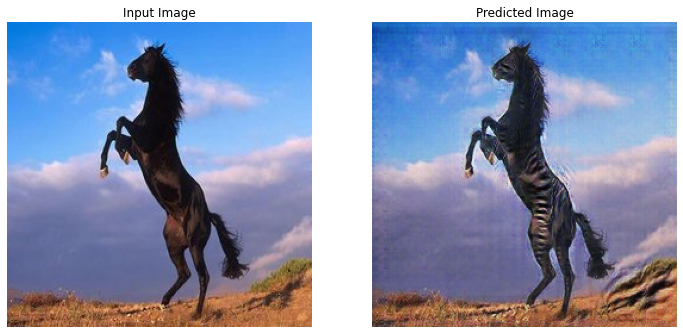

# AIFFEL · Deep Learning Workshops

Notebook-based lessons in generative models, vision, language, and speech, with implementations to explore one concept at a time.

[Notebooks](#explore-the-material) · [Lecture slides](pdf/) · [Getting started](#getting-started)

  

*Horse-to-zebra translation: a saved result from the [CycleGAN notebook](1.%20GAN/2.cyclegan.ipynb), adapted from the TensorFlow tutorial.*

## Explore the material

| Topic | What to explore |
| --- | --- |
| [Generative models](1.%20GAN/) | Fashion-MNIST, CycleGAN, and convolutional VAEs |
| [Recurrent networks](2.RNN/) | Character-level text generation with Shakespeare |
| [From scratch](3.from_scratch/) | Classification, regression, CNNs, and RNNs |
| [Convolution](4.convolution/) | Convolution operations and image filtering |
| [Transformers](5.Transformer/) | Attention, positional encoding, translation, and vision transformers |
| [Super-resolution](6.SR/) | SRCNN and SRGAN notebooks |
| [Embeddings](7.Embedding/) | Face, image–text, sentence, and speech representations |
| [Image translation](8.pix2pix/) | GANs, conditional GANs, and pix2pix |
| [Speech recognition](9.ASR/) | Data preparation, audio analysis, training, and inference |
| [OCR](10.OCR/) | Text recognition |
| [Unsupervised learning](11.Unsupervised/) | K-means, Gaussian mixtures, PCA, and VAEs |

## Getting started

1. Browse the notebooks on GitHub, or clone the repository and open a notebook in Jupyter.
2. Follow the imports and setup cells for the selected lesson. The collection uses both **TensorFlow** and **PyTorch**; there is no single pinned environment for every topic.
3. Check dataset paths and GPU settings before running training cells. Some lessons download data or depend on external model packages.

For a first lesson, start with [classification on Fashion-MNIST](3.from_scratch/tf1.%20classification%20-%20Fashion%20MNIST.ipynb). For generative modeling, explore [CycleGAN](1.%20GAN/2.cyclegan.ipynb). The [PDF slides](pdf/) provide accompanying lecture material.

## Sources

The collection includes adapted tutorials as well as course exercises. Original source links, author credits, and license notices remain in the individual notebooks. The preview above is an existing notebook output, not a separate benchmark.

Full project notes

<!-- preserved-project-notes:start -->
# aiffel_2022
<!-- preserved-project-notes:end -->

